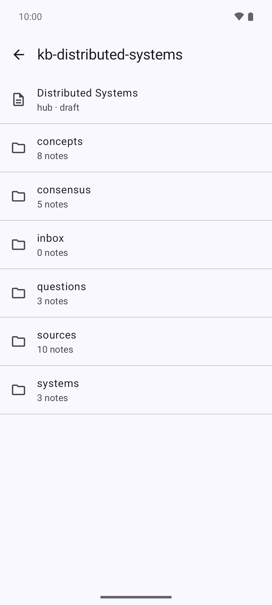
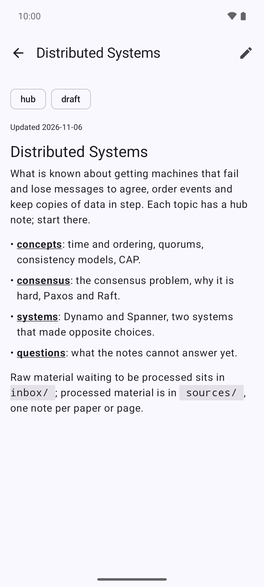
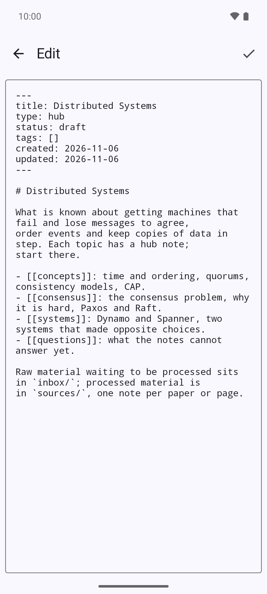

# vademo

Read and edit markdown knowledge bases on an Android phone, synced with
their GitHub repositories. A knowledge base is a git repository of linked
notes that follows the layout in
[kb-distributed-systems](https://github.com/carlospinto4p/kb-distributed-systems),
which is also the example the app opens by default.

<p>
  
  
  
</p>

## Build and install

```bash
./gradlew assembleDebug
./gradlew installDebug     # phone connected with USB debugging on
```

## Install without a computer

Every push builds the debug APK (`.github/workflows/build-apk.yml`).
Pushes to `main`, and runs started by hand from the Actions tab, also
replace the `debug-latest` prerelease, whose asset is a plain `.apk`.

On the phone: open the repository's **Releases**, tap the APK under
`debug-latest`, and allow the browser to install unknown apps once.
Any other branch's build is under its run in the **Actions** tab, as a
zipped artifact.

It is signed with the debug key in `app/debug.keystore`, which is
committed so that every build — from CI or from this computer — carries
the same signature and installs over the last one. It still never
upgrades a release-signed install (or the other way round), and a build
made before v0.2.2 was signed with a throwaway key, so upgrading from
one of those needs the app uninstalled once first.

## First run

1. Tap **Sync** on the home screen. The example knowledge base,
   `kb-distributed-systems`, is public, so it downloads with no setup.
2. To use your own, open **Settings** (gear icon) and edit the list (one
   HTTPS clone address per line).
3. For a private repository, or to send your edits back to GitHub, also
   paste a GitHub personal access token with the `repo` scope (classic)
   or `Contents: Read and write` (fine-grained), and the name and email
   to put on commits. Without a name and email, an edit stays on the
   phone and sync tells you what is missing.

## Reading a note

Pinch with two fingers to make the text bigger or smaller. The text
reflows to the width of the screen, so a larger size never means
scrolling sideways, and the size is kept for every note until it is
changed again.

## Syncing

Tap **Sync** to send notes edited on the phone and get changes made
elsewhere. If the same lines changed on both sides, the knowledge base
shows "Changed here and on GitHub: tap to choose"; tap it and pick the
phone's version, GitHub's, or combine them by hand.

## Tests

```bash
./gradlew testDebugUnitTest          # on this computer
./gradlew connectedDebugAndroidTest  # on an emulator or phone
```

## Licence

MIT, see [`LICENSE`](LICENSE).
