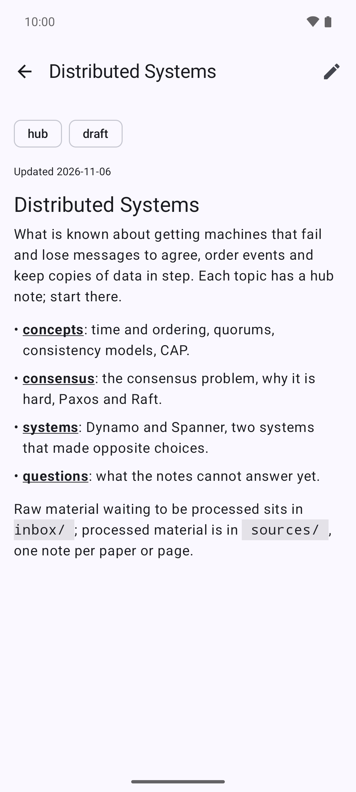
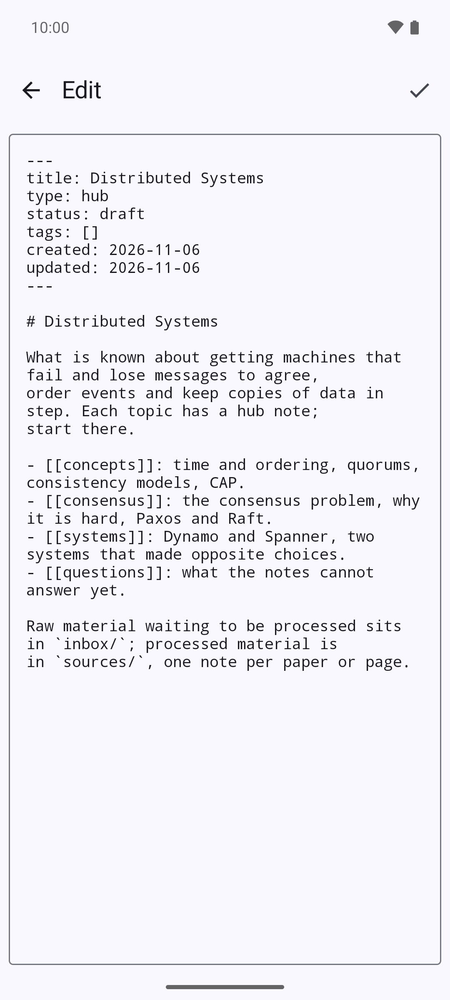

# vademo

Read and edit markdown knowledge bases on an Android phone, synced with
their GitHub repositories. A knowledge base is a git repository of linked
notes that follows the layout in
[kb-distributed-systems](https://github.com/carlospinto4p/kb-distributed-systems),
which is also the example the app opens by default.

<p>
  
  
  
</p>

## Build and install

```bash
./gradlew assembleDebug
./gradlew installDebug     # phone connected with USB debugging on
```

## Install without a computer

Every push builds the debug APK (`.github/workflows/build-apk.yml`).
Pushes to `main`, and runs started by hand from the Actions tab, also
replace the `debug-latest` prerelease, whose asset is a plain `.apk`.

On the phone: open the repository's **Releases**, tap the APK under
`debug-latest`, and allow the browser to install unknown apps once.
Any other branch's build is under its run in the **Actions** tab, as a
zipped artifact.

It is signed with the debug key in `app/debug.keystore`, which is
committed so that every build — from CI or from this computer — carries
the same signature and installs over the last one. It still never
upgrades a release-signed install (or the other way round), and a build
made before v0.2.2 was signed with a throwaway key, so upgrading from
one of those needs the app uninstalled once first.

## First run

1. Tap **Sync** on the home screen. The example knowledge base,
   `kb-distributed-systems`, is public, so it downloads with no setup.
2. To use your own, open **Settings** (gear icon) and edit the list (one
   HTTPS clone address per line).
3. For a private repository, or to send your edits back to GitHub, also
   paste a GitHub personal access token with the `repo` scope (classic)
   or `Contents: Read and write` (fine-grained), and the name and email
   to put on commits. Without a name and email, an edit stays on the
   phone and sync tells you what is missing.

## Reading a note

Pinch with two fingers to make the text bigger or smaller. The text
reflows to the width of the screen, so a larger size never means
scrolling sideways, and the size is kept for every note until it is
changed again.

## Map of notes

The map button at the top of a knowledge base shows every note as a box
and every `[[link]]` between two notes as a line, with notes of the same
folder in the same colour. Drag to move around, pinch to zoom, and tap a
box to open that note. The picture is worked out from the notes each
time, so nothing is saved and it always matches what is on the phone.

## Diagrams

Agents working on a knowledge base can draw diagrams with tyfold's graph
tool; each one is a file in the knowledge base's `.tyfold-graphs/` folder
and syncs like a note. The Diagrams button at the top of a knowledge base
lists them. A diagram opens with drag and pinch-zoom, and tapping a box
that stands for a note opens that note. A note shows a diagram in place
where it has a line `![[name]]`; tap it to open the diagram.

Diagrams can be edited on the phone too. Long-press a box or a group for
what can be done to it (edit, connect to another box, status, category,
groups, delete); tap an arrow's label or its small round handle to edit
the arrow. The menu at the top right adds boxes and groups and edits the
legend, and Undo and Redo sit beside it. Edits are saved to the file as
you go and sync like edited notes. Nothing is saved while a sync conflict
in that knowledge base waits to be resolved.

New diagram on the Diagrams list starts an empty one. In a box's actions,
Select starts picking several boxes: tap others to add them, then use the
top bar to group, copy, cut, duplicate or delete them together, or drag a
selected box to move them all. Where you drag boxes is remembered on this
phone only; Tidy in the menu puts everything back where the layout wants
it.

Share as image and Share as Mermaid, in a diagram's menu, send it through
Android's share sheet: a PNG of the whole diagram, or a Mermaid chart that
renders where it is pasted, such as in a GitHub issue.

## Syncing

Tap **Sync** to send notes edited on the phone and get changes made
elsewhere. If the same lines changed on both sides, the knowledge base
shows "Changed here and on GitHub: tap to choose"; tap it and pick the
phone's version, GitHub's, or combine them by hand.

## Tests

```bash
./gradlew testDebugUnitTest          # on this computer
./gradlew connectedDebugAndroidTest  # on an emulator or phone
```

## Licence

MIT, see [`LICENSE`](LICENSE).
