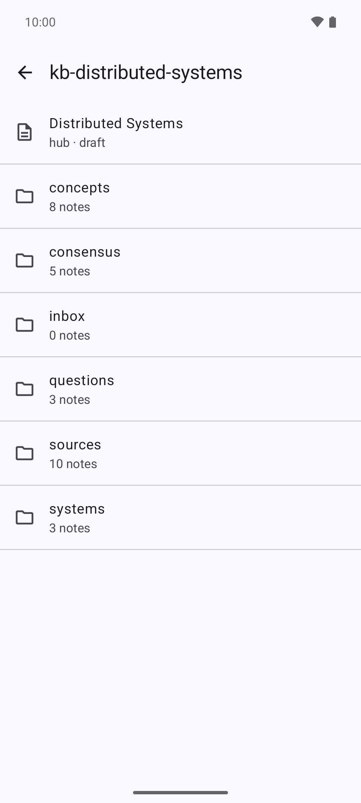

# vademo

Read and edit markdown knowledge bases on an Android phone, synced with
their GitHub repositories. A knowledge base is a git repository of linked
notes that follows the layout in
[kb-distributed-systems](https://github.com/carlospinto4p/kb-distributed-systems),
which is also the example the app opens by default.

<p>
  
  
  
</p>

## Build and install

```bash
./gradlew assembleDebug
./gradlew installDebug     # phone connected with USB debugging on
```

## Install without a computer

Every push builds the debug APK (`.github/workflows/build-apk.yml`).
Pushes to `main`, and runs started by hand from the Actions tab, also
replace the `debug-latest` prerelease, whose asset is a plain `.apk`.

On the phone: open the repository's **Releases**, tap the APK under
`debug-latest`, and allow the browser to install unknown apps once.
Any other branch's build is under its run in the **Actions** tab, as a
zipped artifact.

It is signed with the debug key in `app/debug.keystore`, which is
committed so that every build — from CI or from this computer — carries
the same signature and installs over the last one. It still never
upgrades a release-signed install (or the other way round), and a build
made before v0.2.2 was signed with a throwaway key, so upgrading from
one of those needs the app uninstalled once first.

## First run

1. Tap **Sync** on the home screen. The example knowledge base,
   `kb-distributed-systems`, is public, so it downloads with no setup.
2. To use your own, open **Settings** (gear icon). Each knowledge base is
   a row with its name, owner and whether it is private; remove one with
   its ✕. Add one by typing `owner/name` (a GitHub repository) or any
   HTTPS clone address. Two addresses that end in the same name, such as
   `a/kb-x` and `b/kb-x`, cannot both be listed.
3. For a private repository, or to send your edits back to GitHub, also
   paste a GitHub personal access token with the `repo` scope (classic)
   or `Contents: Read and write` (fine-grained), and the name and email
   to put on commits. Without a name and email, an edit stays on the
   phone and sync tells you what is missing.
4. With a token, **On your GitHub** lists every repository it can reach
   whose name starts with `kb-`, public and private (yours, shared with
   you, or in your organisations). Tap **Add** on one to sync it. A
   fine-grained token lists only the repositories it was given.

## Opening a knowledge base

A knowledge base opens on a picture of it: its main diagram, the one its
`index.md` shows with `![[name]]` (or its only diagram), and the map of
notes when it has none. The bar at the bottom switches between Map,
Diagrams and Notes, and the knowledge base opens on the one it was left on
next time. On a main diagram, the list button at the top lists all the
knowledge base's diagrams. Above the bar, "Continue reading" lists the last
five notes opened in that knowledge base, newest first.

The app reopens the knowledge base it was left in; go back to the list of
knowledge bases before leaving to start there next time.

## Folders, Recent, Types, Tags and Health

The Notes tab shows the knowledge base's folders. The tabs above them list the same
notes other ways: Recent by the date each was last updated, Types grouped
by type (all sources in one row), and Tags with every tag and how many
notes carry it. Tap a tag, or the sources row, to see those notes in
search.

Health counts what needs looking after: notes nothing links to, notes
with a link to a note that does not exist, notes with an `(unverified)`
marker, open questions (`type: question` still at `status: draft`), and
files waiting in `inbox/`, and notes whose file name another note also
has (a `[[link]]` to that name opens either one). Tap a row to see those notes in search.

## Reading a note

Pinch with two fingers to make the text bigger or smaller. The text
reflows to the width of the screen, so a larger size never means
scrolling sideways, and the size is kept for every note until it is
changed again.

Under the text, "Links to" lists the notes this one links to and "Linked
from" the notes that link to it. Tap one to open it. At the top, "In …"
names the topic hub the note sits under (a hub's is the index); tap it to
go up without Back or search. Tap the type, status or a tag at the top of a note to
search for the other notes that share it.

A table sizes its columns by their content: short columns keep their
width and long ones wrap to fill the rest of the screen.

The two arrows at the top left work as in a browser. Back returns to
where you came from, whether a note, a diagram, search or a folder.
After going back, Forward opens again what you just left.

## Writing a new note

Inside a folder, New note starts a note from one of the knowledge base's
`templates/`. Pick a template, type a title, and change the file name if
it needs one (a `src-` prefix for a source, say); it starts as the title
in kebab-case, and a name another note already has is refused. The
editor opens with the title, today's date as `created` and `updated`, the
`# heading` and `Hub: [[<folder>]]` filled in. The note is written when
you tap the check mark; going back without saving leaves nothing behind.

## Search

The search button on the home screen searches every knowledge base on the
phone; the one at the top of a knowledge base starts with `kb:<name>`, so
it searches only that one. Words are found in titles, headings and text,
and a note with the word in its title comes first. Filters narrow the
list, and every word and filter must match:

```
type:question  status:draft  tag:consensus
updated:>2026-09-01  updated:2026-09   (a bare date matches its start)
kb:distributed-systems
links:quorum     notes linking to quorum
folder:inbox     notes inside a folder
is:orphan        notes nothing links to
is:unverified    notes with an (unverified) marker
is:broken        notes linking to a note that does not exist
is:duplicate     notes whose file name another note also has
```

Before anything is typed, search lists saved searches: the Health checks,
then your own. Tap the bookmark at the top to save the current search
under a name, and the bin on a row to delete it. Saved searches stay on
the phone and are not synced.

## Map of notes

The Map tab of a knowledge base starts with its shape: `index.md` and one
large box per topic folder, saying how many notes it holds, with a line
wherever notes of the two link with `[[...]]`. Tap a topic to open it in
place, showing its notes; tap a note, or the topic's hub, to read it, and
long-press any of the topic's boxes to fold it again. The Every note chip
opens or folds all the topics at once, and the Sources chip adds the
source notes, hidden at first since they outnumber the rest. Notes of the
same folder share a colour.

Drag to move around, pinch to zoom, and a drag let go while still moving
coasts on. A big map opens at a size its titles can be read at; the
button at the bottom right shows all of it and zooms back in, and a double
tap zooms in round the tap and back out. The picture is worked out from
the notes each time, so nothing is saved and it always matches what is on
the phone.

From a note, the map button at the top shows it on a map of its own: the
note, in the centre, and the notes up to two links from it, each drawn on
its own, so related notes can be wandered to by picture.

## Diagrams

Agents working on a knowledge base can draw diagrams with tyfold's graph
tool; each one is a file in the knowledge base's `.tyfold-graphs/` folder
and syncs like a note. The Diagrams tab of a knowledge base shows its main
diagram, or lists them all when it has none. A diagram opens with drag and pinch-zoom, and tapping a box
that stands for a note opens that note. A diagram too big to read whole
opens at a readable size where it starts (its top left, or its top when
drawn top to bottom); Show all, double tap and Zoom to read work as on
the map. A note shows a diagram in place
where it has a line `![[name]]`; tap it to open the diagram. A diagram
too wide or tall to read at the note's width shows the part where it
starts, faded at the cut.

Diagrams can be edited on the phone too. Long-press a box or a group for
what can be done to it (edit, connect to another box, status, category,
groups, delete); tap an arrow's label or its small round handle to edit
the arrow. The menu at the top right adds boxes and groups and edits the
legend, and Undo and Redo sit beside it. Edits are saved to the file as
you go and sync like edited notes. Nothing is saved while a sync conflict
in that knowledge base waits to be resolved.

New diagram on the Diagrams list starts an empty one. In a box's actions,
Select starts picking several boxes: tap others to add them, then use the
top bar to group, copy, cut, duplicate or delete them together, or drag a
selected box to move them all. Where you drag boxes is remembered on this
phone only; Tidy in the menu puts everything back where the layout wants
it.

Share as image and Share as Mermaid, in a diagram's menu, send it through
Android's share sheet: a PNG of the whole diagram, or a Mermaid chart that
renders where it is pasted, such as in a GitHub issue.

## Syncing

Tap **Sync** to send notes edited on the phone and get changes made
elsewhere. If the same lines changed on both sides, the knowledge base
shows "Changed here and on GitHub: tap to choose"; tap it and pick the
phone's version, GitHub's, or combine them by hand.

## Tests

```bash
./gradlew testDebugUnitTest          # on this computer
./gradlew connectedDebugAndroidTest  # on an emulator or phone
```

## Licence

MIT, see [`LICENSE`](LICENSE).
